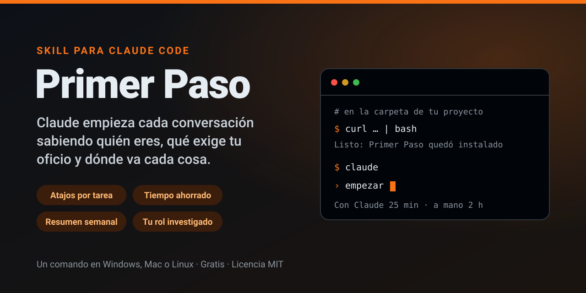

# Primer Paso



Instálalo en tu carpeta de trabajo, escribe «empezar» y en unos minutos tienes
un espacio hecho a tu medida. Desde ese día, cada tarea queda registrada,
Claude aprende de tus correcciones y ves cuánto tiempo te ahorras.

## Instalación

Necesitas tener [Claude Code](https://claude.com/claude-code) instalado (la
[guía de instalación](docs/instalacion.md) trae el comando para instalarlo en
Windows y en Mac). Haz los pasos en orden: copia cada comando completo, pégalo
en la terminal y presiona Enter. La guía explica cada paso con más detalle.

### En Windows

**1. Abre PowerShell.** Presiona la tecla Windows, escribe `PowerShell` y
presiona Enter.

**2. Entra en tu carpeta de trabajo.** Puede ser cualquier carpeta, donde tú
quieras, nueva o con tus archivos. Escribe `cd`, un espacio y la ruta de tu
carpeta entre comillas (la del ejemplo no existe; si no sabes la tuya, salta al
paso 3 y el instalador te la pregunta):

```powershell
cd "C:\ruta\de\tu\carpeta"
```

Atajo: abre la carpeta en el Explorador de archivos, haz clic en la barra de
dirección, escribe `powershell` y presiona Enter. PowerShell se abre ya dentro
de ella (esto reemplaza los pasos 1 y 2).

**3. Instala el skill Primer Paso** en esa carpeta. Usa este comando y no el de
Mac, que en PowerShell falla:

```powershell
irm https://raw.githubusercontent.com/SEOenMedellin/espacio-trabajo-claude/main/install.ps1 | iex
```

**4. Abre Claude y escribe `empezar`:**

```powershell
claude
```

### En Mac

**1. Abre Terminal.** Presiona Cmd + Espacio, escribe `Terminal` y presiona
Enter.

**2. Entra en tu carpeta de trabajo.** Puede ser cualquier carpeta, donde tú
quieras, nueva o con tus archivos. Escribe `cd` y un espacio, arrastra la
carpeta desde el Finder hasta la ventana de Terminal y presiona Enter (si no
lo haces, el instalador te pregunta la carpeta):

```bash
cd "/ruta/de/tu/carpeta"
```

**3. Instala el skill Primer Paso** en esa carpeta. Este comando es solo para
Mac: en Windows falla con «parámetro 'fsSL'».

```bash
curl -fsSL https://raw.githubusercontent.com/SEOenMedellin/espacio-trabajo-claude/main/install.sh | bash
```

**4. Abre Claude y escribe `empezar`:**

```bash
claude
```

### Lo que vas a ver

En el paso 3, el instalador revisa si tienes Git, Python, Node.js y
Playwright, y te pregunta antes de instalar lo que falte: responde `S` y
Enter.

En el paso 4, antes de preguntarte nada, Claude lee lo que ya tienes en tu
carpeta (documentos, hojas de cálculo, presentaciones) y te cuenta lo que
entendió para que lo corrijas. Luego te explica para qué sirve cada dato y te
hace unas preguntas, casi todas para elegir. Si quieres, puedes compartir tu
hoja de vida en PDF, tu perfil de LinkedIn descargado en PDF o un enlace del
proyecto: así sabe qué habilidades tienes y cuáles debe aportar. Esa
información es solo para ayudarte en tu trabajo, queda en tu carpeta y no se
comparte con otras personas. Si en la carpeta hay skills sin instalar, las
instala. No mueve ni cambia tus archivos, y los que pueden tener claves no se
abren.

Si algo falla, la [guía de instalación](docs/instalacion.md#si-algo-falla) tiene
cada mensaje de error con su solución.

Para volver otro día, abre la terminal, entra a tu carpeta como en el paso 2
y escribe `claude`.


## Lo que cambia en tu día

Hoy le repites a Claude tu contexto en cada conversación. Le corriges lo mismo
que ayer, guarda archivos donde no van y lo que resolvió la semana pasada se
pierde. Con Primer Paso eso se acaba desde la primera sesión.

### Tus tareas salen igual cada vez

Cada tarea que haces seguido se convierte en un comando con su nombre:
`/informe-mensual`, `/acta-de-reunion`. Lo escribes y Claude sigue los mismos
pasos, con el formato de tu oficio y las correcciones que ya le hiciste.

### Sabes cuánto tiempo te ahorras

Al cerrar cada tarea, Claude te pregunta cuánto te habría tomado a mano y lo
compara con lo que tardó con él:

> Con Claude: 25 min; a mano: 2 h. Te ahorraste 1 h 35 min.

Cada semana te muestra el total, por tipo de tarea, listo para ti o para tu
jefe.

### Claude conoce las reglas de tu oficio

Antes de proponerte nada, investiga tu rol en fuentes oficiales: de qué
respondes, qué normas te rigen, qué registros debes conservar, qué tareas son
habituales y qué programas necesitas. De ahí salen las reglas de tu espacio, y
Claude las respeta en cada entrega.

### Lo que ya resolviste no se vuelve a investigar

Cada tarea deja su carpeta con el entregable y una nota de lo aprendido. Antes
de empezar algo nuevo, Claude revisa qué se hizo antes, qué funcionó y qué le
corregiste.

### Aprovecha lo que ya tienes

Si tu carpeta ya trae habilidades instaladas, las revisa una por una: qué
hacen, si lo que saben sigue vigente y si alguna tiene un riesgo, como una
contraseña a la vista o un envío de datos fuera de tu equipo. Las tareas que
ya cubren las siguen haciendo ellas.

## Cómo funciona

1. **Instalas el skill** con el comando de arriba. Revisa si tienes Git,
   Python, Node.js y Playwright y te ofrece instalar lo que falte.
2. **Escribes «empezar»** y respondes unas preguntas: tu cargo, tu proyecto,
   tu objetivo, tus tareas y tus herramientas.
3. **Revisas la propuesta.** Ves tus carpetas, tus atajos y lo que encontró de
   tu rol. Nada se crea hasta que dices que sí.
4. **Trabajas.** Una lista de arranque te dice qué falta para quedar al 100 %.
   Escribe «sigamos» y te ayuda con lo siguiente; la primera tarea la hacen
   juntos.

## Lo que puedes pedirle

| Escribe | Y pasa esto |
|---|---|
| empezar | Te entrevista y prepara tu espacio |
| `/<tu-tarea>` | Hace tu tarea habitual con los mismos pasos de siempre |
| sigamos | Completa lo siguiente de tu lista de arranque |
| ¿cómo me fue esta semana? | Te muestra tareas, tiempo ahorrado y lo aprendido |
| tengo un proyecto nuevo | Amplía tu espacio sin perder nada |
| revisa mis skills | Revisa las habilidades que ya tienes |
| ordena mis carpetas | Te propone dónde va cada archivo y mueve solo lo que apruebes |

La guía completa, función por función, está en [docs/guia.md](docs/guia.md).

## Preguntas frecuentes

**¿Sirve para mi área?**
Sí. No asume empresa, área ni herramienta: todo sale de tu entrevista y de la
investigación de tu rol. Lo mismo sirve para consultoría que para análisis de
datos, contenido, desarrollo o gestión.

**¿Puede mover o borrar mis archivos?**
No sin tu permiso. Nada se crea sin que apruebes la propuesta, nada se mueve
sin un sí explícito y nada de lo que ya tenías se borra ni se sobrescribe.

**¿Mis contraseñas quedan seguras?**
Nunca pasan por el chat. Se guardan en un archivo de tu equipo que no se sube
a git, y Claude te explica cómo dejarlas ahí cuando haga falta.

**¿Cuánto cuesta?**
Nada. Es software libre con licencia MIT y todo queda en tu equipo: sin
servidores ni cuentas nuevas.

**¿Puedo quitarlo cuando termine?**
Sí. Cuando tu espacio queda listo, te ofrece desactivarlo o eliminarlo. Tus
carpetas, atajos, memoria y resumen semanal siguen funcionando igual.

**¿Cómo lo actualizo?**
Vuelve a ejecutar la línea de instalación. Se actualiza el asistente y tu
trabajo queda intacto.

**Prefiero no ejecutar un script descargado.**
Tiene sentido. Lee antes [install.sh](install.sh) o [install.ps1](install.ps1),
o copia a mano la carpeta `skill/` en `.claude/skills/primeros-pasos` dentro
de tu proyecto.

## Empieza hoy

Sigue los cuatro pasos de [Instalación](#instalación) y escribe «empezar» en
Claude Code. En unos minutos tienes tu espacio
listo y tu primera tarea medida.

---

¿Quieres colaborar? Lee [docs/contribuir.md](docs/contribuir.md). Licencia
[MIT](LICENSE).
